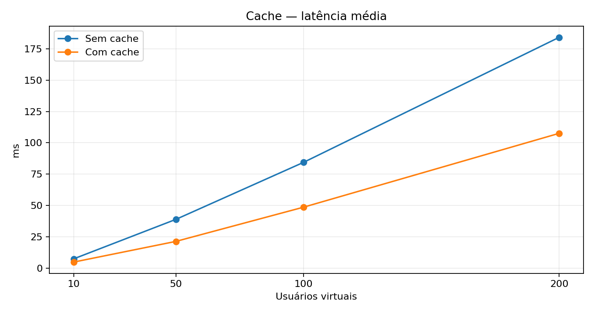
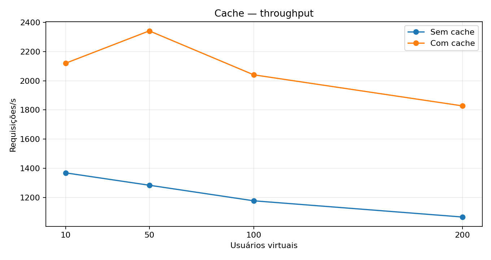
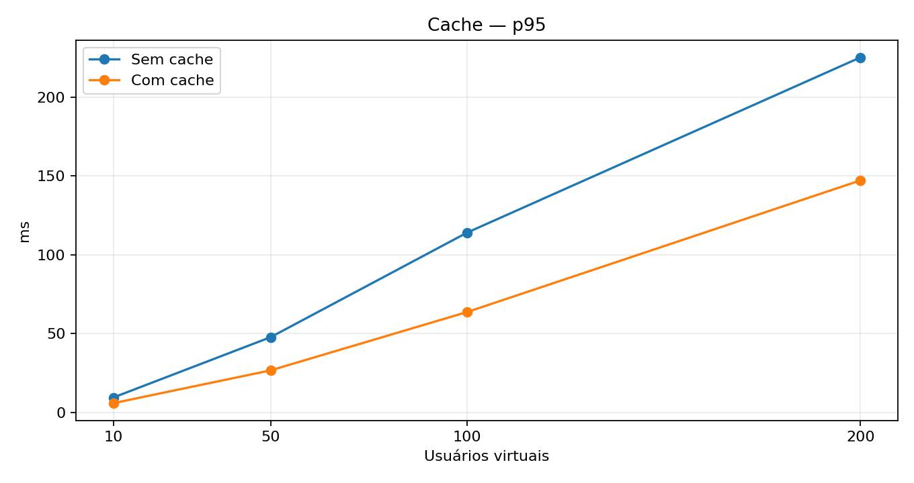
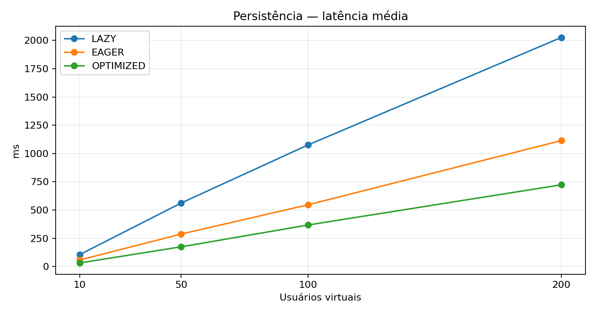
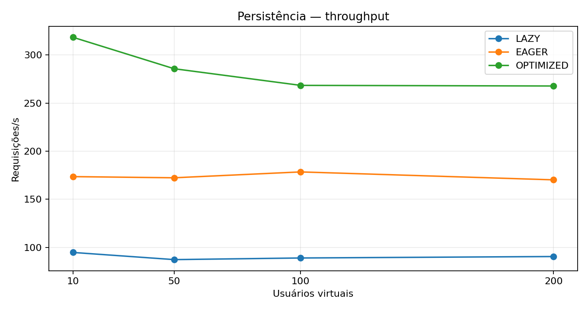
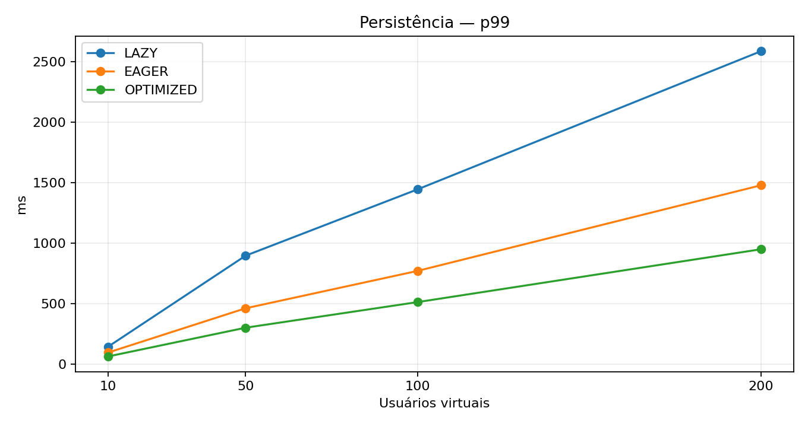
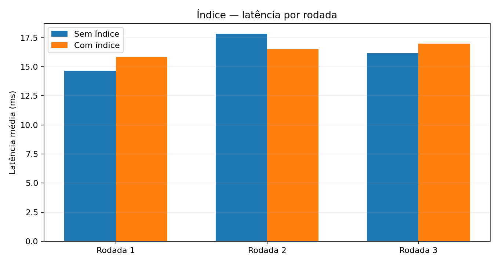

# Trabalho Prático A2 — Otimização de Web Services

**Universidade Veiga de Almeida (UVA)** — Análise e Otimização de Sistemas  
**Professor:** André Lucio  
**Integrantes:** Gabriel Oazem Loureiro Lauria; Rodrigo Aguiar Leão; João Victor Lima Bernardo; Fellipe de Melo Fraga; Gabriel de Souza Eller; Fernando Davi Pessoa Lima  
**Natureza dos resultados:** medições locais fornecidas pelo grupo (arquivos JSON), sem dados simulados nesta análise.

> **Escopo das evidências:** as tabelas principais foram consolidadas a partir dos JSONs válidos do projeto e dos testes funcionais mostrados no Swagger. A comparação de índices usa três execuções por configuração; cache com 10 usuários também teve três execuções reportadas pelo grupo. Nas cargas restantes de cache e persistência, as tabelas ainda apresentam uma execução válida por cenário. Os testes de TTL, consultas ORM para 30 e 100 pedidos, hardware, contagem de registros e reprodução em um segundo banco foram demonstrados durante a execução, mas as respectivas capturas devem ser preservadas pelo grupo para anexação caso solicitadas.

## 1. Introdução

A API REST representa um catálogo de produtos e pedidos e foi construída para avaliar o impacto de (i) cache, (ii) estratégias de carregamento de relacionamentos por ORM e (iii) índices de banco de dados. O objetivo não é apenas implementar as técnicas, mas mensurar latência, p95, p99, throughput e taxa de erros sob diferentes níveis de carga.

## Atendimento aos três itens solicitados pelo professor

Os três itens práticos do enunciado estão implementados. Esta tabela apresenta a correspondência entre requisito, código-fonte, serviço utilizado e evidência experimental.

| Item do enunciado | Implementação / onde encontrar | Como demonstrar | Evidências |
| --- | --- | --- | --- |
| **Item 1 — Utilização de cache** | `app/main.py`: `product_no_cache`, `product_cache`, `update_product`, `cache_stats`, `reset_cache`; `_cache`, `_cache_lock` e `CACHE_TTL` | Swagger: `GET /api/products/1/no-cache`, `GET /api/products/1/cache`, `PATCH /api/products/1` e `GET /api/cache/stats`; demonstrar miss, hit, invalidação e TTL | Seção 3; `results/cache/`; gráficos `charts/cache_*.png`; respostas do Swagger |
| **Item 2 — Otimização de consultas** | `app/main.py`: `orders_by_strategy` com `joinedload` e `selectinload`; `search_orders`, `index_explain`, `index_create`, `index_drop` | Swagger: `GET /api/orders/lazy?limit=30`, versões `eager` e `optimized`, `GET /api/index/explain` antes/depois de `POST /api/index/create` | Seção 4; tabelas de SQL para 10/30/100 pedidos; `results/persistence/` e `results/indexes/`; gráficos de persistência e índices |
| **Item 3 — Testes de desempenho** | `scripts/load_test.py` (requisições concorrentes, métricas e JSON); `scripts/plot_results.py` (gráficos); `scripts/run_matrix.py` (automação auxiliar) | Iniciar a API e executar o script com `--scenario` e `--users` configurados; comparar 10, 50, 100 e 200 usuários | Seção 5; JSONs de resultados; sete figuras em `charts/` |

**Observação sobre o Item 3:** o enunciado permite ferramenta equivalente às opções JMeter, k6, Gatling e Locust. Foi construído um gerador de carga local em Python, descrito na seção 5, com as métricas solicitadas. Sua aceitação definitiva cabe ao professor. Os três itens *implementados* não dispensam a apresentação prática e o relatório de resultados.

## 2. Arquitetura e tecnologias

- **API:** Python 3.11+ e FastAPI.
- **Persistência:** SQLAlchemy 2.x com SQLite (configuração local; `DATABASE_URL` permite outro banco com driver apropriado).
- **Entidades relacionadas:** `categories`, `products`, `orders` e `order_items`.
- **Dados efetivamente verificados no banco principal:** 50 categorias, 10.000 produtos, 10.000 pedidos e 30.000 itens de pedidos (**50.050 registros** no total).
- **Cache:** memória local do processo com TTL padrão de 30 s, protegido por `threading.Lock`.
- **Carga:** script `scripts/load_test.py` com `ThreadPoolExecutor`, `requests.Session` por usuário virtual e reaproveitamento de conexões HTTP.
- **Visualização:** matplotlib para gráficos desta entrega.

### 2.1 Modelo relacional

`categories (1) ← (N) products (1) ← (N) order_items (N) → (1) orders`

### 2.2 Como executar

```powershell
python -m venv .venv
.\.venv\Scripts\Activate.ps1
python -m pip install -r requirements.txt
python -m scripts.seed
uvicorn app.main:app --host 127.0.0.1 --port 8000
```

O script de população oferece `--size` e `--reset`; **não use `--reset` no banco principal antes das medições**, pois ele recria os dados. O Swagger fica em `http://127.0.0.1:8000/docs`. Todas as dependências principais, incluindo `requests`, `pytest` e `httpx`, já constam em `requirements.txt`. Para verificar os testes automatizados, execute `python -m pytest -v` (três testes aprovados no ambiente do grupo).

### 2.3 Endpoints

| Endpoint | Uso |
| --- | --- |
| `GET /api/products/{product_id}/no-cache` | Consulta ao banco |
| `GET /api/products/{product_id}/cache` | Consulta ao cache ou banco |
| `PATCH /api/products/{product_id}` | Atualização de preço e invalidação |
| `GET /api/cache/stats` | Hits, misses, invalidações e TTL |
| `DELETE /api/cache` | Limpeza do cache |
| `GET /api/orders/{strategy}` | LAZY, EAGER e OPTIMIZED |
| `GET /api/orders/search` | Filtro de cliente e ordenação |
| `GET /api/index/explain` | Plano de execução |
| `POST /api/index/create` | Cria índice |
| `DELETE /api/index` | Remove índice experimental |
| `GET /health` | Saúde da API |


**Observação de implementação:** a rota estática `/api/orders/search` precisa ser declarada antes da rota dinâmica `/api/orders/{strategy}` para não ser capturada como estratégia inválida. Essa correção foi feita durante os testes.

## 3. Implementação de cache

### 3.1 Política, justificativa e invalidação

As consultas de produto são repetidas e o preço pode mudar. Cada entrada associa um ID de produto a um valor e a um instante de expiração (`time.monotonic() + TTL`). No cache hit, o serviço devolve o objeto sem consultar o banco; no miss, lê o banco e armazena o retorno. O `PATCH` altera o preço e remove a entrada do cache. O TTL padrão configurado é **30 s**. O cache é local ao processo e não compartilhado entre workers.

Nos testes funcionais reportados pelo grupo, a consulta do produto 1 sem cache retornou `source=database` e `sql_queries=1`; a consulta subsequente com cache retornou `source=cache` e `sql_queries=0`. A atualização de preço de **29284 centavos (R$ 292,84)** para **35000 centavos (R$ 350,00)** retornou `updated=true` e `cache_invalidated=true`. Após a atualização, o GET devolveu o novo valor do banco, e a leitura posterior veio do cache. Esse procedimento evidencia hit, miss e invalidação. **A expiração também foi demonstrada:** após limpar o cache, consultar o produto 1, repetir a consulta dentro do TTL e aguardar mais de 35 segundos, o novo GET retornou `source=database` e `sql_queries=1`, conforme print apresentado pelo grupo. Isso é distinto da invalidação por PATCH.

### 3.2 Comparação de desempenho — cache

Os resultados a seguir vêm dos arquivos `cache_corrigido.json` e `sem_cache_corrigido.json` para 10 usuários, e dos arquivos `com_cache_{50,100,200}.json` / `sem_cache_{50,100,200}.json` para cargas maiores. Os JSONs de diagnóstico anteriores apresentaram falhas de conexão e não são incluídos nesta comparação.

**Sem cache**

| Usuários | Média (ms) | p95 (ms) | p99 (ms) | Req/s | Erros (%) |
| --- | --- | --- | --- | --- | --- |
| 10 | 7,300 | 9,505 | 11,170 | 1.368,413 | 0,0 |
| 50 | 38,821 | 47,743 | 65,416 | 1.283,645 | 0,0 |
| 100 | 84,390 | 114,070 | 134,072 | 1.176,945 | 0,0 |
| 200 | 184,203 | 225,107 | 240,308 | 1.065,614 | 0,0 |


**Com cache**

| Usuários | Média (ms) | p95 (ms) | p99 (ms) | Req/s | Erros (%) |
| --- | --- | --- | --- | --- | --- |
| 10 | 4,711 | 5,916 | 7,237 | 2.120,996 | 0,0 |
| 50 | 21,239 | 26,699 | 31,863 | 2.342,433 | 0,0 |
| 100 | 48,581 | 63,708 | 84,987 | 2.041,060 | 0,0 |
| 200 | 107,538 | 147,129 | 180,016 | 1.827,895 | 0,0 |


**Ganhos relativos, com cache em relação a sem cache:**

| Usuários | Redução da latência média | Aumento do throughput |
| --- | --- | --- |
| 10 | 35,5% | 55,0% |
| 50 | 45,3% | 82,5% |
| 100 | 42,4% | 73,4% |
| 200 | 41,6% | 71,5% |








**Análise:** nas quatro cargas das execuções principais válidas, o cache teve menores latências e maior throughput, sem erros HTTP. A vantagem tende a ser maior em leituras repetidas de um mesmo produto com cache aquecido; um miss ainda exige acesso ao banco. O tempo em cache também depende de TTL, sincronização, memória e custo de atualização. Nas cargas de 50, 100 e 200 usuários, ainda há apenas uma execução principal por cenário, portanto diferenças de ambiente e aquecimento podem afetar as estimativas.

### 3.3 Repetições adicionais com 10 usuários

Foram realizadas três rodadas comparáveis de 10 usuários/10 s após a correção do gerador de carga. A segunda e a terceira rodadas foram apresentadas no terminal do grupo; seus JSONs ficam no computador do grupo e devem ser incluídos na versão definitiva da pasta `results/cache/`.

| Rodada | Sem cache: média (ms) | Com cache: média (ms) | Erros nas duas configurações |
| --- | ---: | ---: | ---: |
| 1 | 7,300 | 4,711 | 0% |
| 2 | 6,650 | 4,515 | 0% |
| 3 | 7,307 | 4,527 | 0% |
| **Média das três** | **7,086** | **4,584** | **0%** |

Com base na média das latências médias, a redução foi de aproximadamente **35,3%** a favor do cache. Trata-se de uma média de resultados de execução, não de uma análise estatística inferencial.

## 4. Otimização de consultas

### 4.1 LAZY, EAGER e OPTIMIZED

- **LAZY:** busca os pedidos e carrega coleções de itens quando acessadas. Pode incorrer em N+1 consultas.
- **EAGER:** `joinedload(Order.items)` antecipa os itens com JOIN, mas pode multiplicar as linhas retornadas.
- **OPTIMIZED:** `selectinload(Order.items)` busca pedidos e itens em consultas separadas com filtro `IN`, evitando N+1 e a multiplicação de linhas do JOIN principal.

**Testes funcionais documentados com 10, 30 e 100 pedidos:**

| Pedidos | Itens | Estratégia | Consultas SQL | Tempo no endpoint (ms) |
| ---: | ---: | --- | ---: | ---: |
| 10 | 30 | LAZY | 11 | 15,275 |
| 10 | 30 | EAGER | 1 | 14,576 |
| 10 | 30 | OPTIMIZED | 2 | 4,378 |
| 30 | 90 | LAZY | 31 | 31,213 |
| 30 | 90 | EAGER | 1 | 28,585 |
| 30 | 90 | OPTIMIZED | 2 | 4,694 |
| 100 | 300 | LAZY | 101 | 115,087 |
| 100 | 300 | EAGER | 1 | 10,035 |
| 100 | 300 | OPTIMIZED | 2 | 4,295 |

Os números foram observados em respostas do Swagger fornecidas pelo grupo. A sequência do LAZY (11, 31, 101 consultas) evidencia **N+1**; `joinedload` manteve uma consulta, e `selectinload`, duas, nos limites testados. Os tempos são medições pontuais e não devem ser interpretados como médias de repetições. A contagem SQL é especialmente útil para demonstrar o comportamento do ORM.

### 4.2 Testes de carga das estratégias (30 pedidos por requisição)

**LAZY**

| Usuários | Média (ms) | p95 (ms) | p99 (ms) | Req/s | Erros (%) |
| --- | --- | --- | --- | --- | --- |
| 10 | 105,363 | 125,826 | 144,274 | 94,685 | 0,0 |
| 50 | 561,490 | 693,267 | 897,033 | 87,237 | 0,0 |
| 100 | 1.075,026 | 1.315,971 | 1.445,264 | 88,930 | 0,0 |
| 200 | 2.026,800 | 2.393,433 | 2.588,950 | 90,431 | 0,0 |


**EAGER**

| Usuários | Média (ms) | p95 (ms) | p99 (ms) | Req/s | Erros (%) |
| --- | --- | --- | --- | --- | --- |
| 10 | 57,513 | 70,997 | 95,859 | 173,505 | 0,0 |
| 50 | 286,957 | 391,106 | 461,968 | 172,294 | 0,0 |
| 100 | 545,510 | 699,223 | 770,829 | 178,404 | 0,0 |
| 200 | 1.113,965 | 1.370,479 | 1.479,800 | 170,164 | 0,0 |


**OPTIMIZED**

| Usuários | Média (ms) | p95 (ms) | p99 (ms) | Req/s | Erros (%) |
| --- | --- | --- | --- | --- | --- |
| 10 | 31,385 | 42,730 | 63,581 | 318,382 | 0,0 |
| 50 | 173,872 | 247,927 | 301,236 | 285,684 | 0,0 |
| 100 | 366,757 | 464,570 | 512,923 | 268,377 | 0,0 |
| 200 | 722,782 | 899,725 | 950,360 | 267,724 | 0,0 |








**Análise:** a estratégia OPTIMIZED apresentou a menor latência média e maior throughput nos quatro níveis de carga. O LAZY manteve throughput perto de 90–95 req/s apesar do aumento de usuários e atingiu latência média acima de 2 s na carga de 200 usuários. Os resultados ilustram que o número de consultas não é o único determinante: o custo de JOIN, transferência de linhas e materialização de objetos também importa. O SQL textual do projeto é usado para criação/remoção de índice e EXPLAIN, não para substituir a busca ORM. SQL nativo pode facilitar ajustes específicos, com custos de portabilidade e manutenção.

### 4.3 Índice composto e planos de execução

Consulta estudada:

```sql
SELECT id FROM orders
WHERE customer_name = 'Cliente 0010'
ORDER BY created_at DESC
LIMIT 50;
```

Índice:

```sql
CREATE INDEX idx_orders_customer_date
ON orders(customer_name, created_at DESC);
```

O plano observado **sem índice** foi `SCAN orders` com `USE TEMP B-TREE FOR ORDER BY`; **com índice**, foi `SEARCH orders USING COVERING INDEX idx_orders_customer_date (customer_name=?)`. O uso do índice foi confirmado no plano, mas o benefício de tempo HTTP precisa ser medido, não presumido.

### 4.4 Três rodadas de carga — 10 usuários

| Rodada | Sem índice média (ms) | Com índice média (ms) | Sem índice req/s | Com índice req/s |
| --- | --- | --- | --- | --- |
| 1 | 14,665 | 15,816 | 681,202 | 631,762 |
| 2 | 17,833 | 16,498 | 560,228 | 605,577 |
| 3 | 16,165 | 16,983 | 617,978 | 588,448 |


| Média das três rodadas | Sem índice | Com índice |
| --- | --- | --- |
| Latência média (ms) | 16,221 | 16,432 |
| p95 (ms) | 23,320 | 23,414 |
| p99 (ms) | 29,187 | 29,876 |
| Throughput (req/s) | 619,803 | 608,596 |




A média das três latências médias foi **16,221 ms sem índice** e **16,432 ms com índice**, diferença de aproximadamente **1,3% a mais com índice**. O p95 médio, p99 médio e throughput também foram ligeiramente melhores sem o índice. As diferenças variaram de sinal entre rodadas e são pequenas frente à dispersão; **não há ganho consistente de desempenho HTTP demonstrado com esse índice nessa consulta e nesse dataset**. Isso não invalida o plano de execução: ele evidencia uso do índice, não garantia de menor latência ponta a ponta.

**Custos de índices:** espaço em disco, operações de manutenção durante escritas e possíveis regressões em outras cargas. Índices devem ser escolhidos conforme filtros, ordenação, seletividade e planos efetivamente observados; criar índices em todas as colunas não é uma estratégia adequada.

## 5. Testes de desempenho e metodologia

### 5.1 Ferramenta e configuração

O gerador de carga `scripts/load_test.py` usa threads Python como usuários virtuais e uma `requests.Session()` por thread. Cada usuário executa requisições sequenciais até o encerramento da janela de carga. A coleta usa tempos medidos do cliente e calcula média, p95, p99, throughput e taxa de erros. Percentis e latência média referem-se às **requisições bem-sucedidas**; o throughput total pode incluir erros, enquanto `successful_throughput_req_s` conta apenas sucessos. As execuções válidas incluídas tiveram 0% de erros.

As durações foram configuradas para 10 segundos; o tempo real pode ultrapassar esse intervalo enquanto requisições iniciadas ainda terminam. Os resultados refletem a máquina e o servidor local usados pelo grupo, não representam estimativa de produção.

### 5.2 Execução reproduzível

No terminal 1, mantenha `uvicorn app.main:app --reload` ativo. No terminal 2, rode: 

```powershell
python -m scripts.load_test --users 10 --duration 10 --scenario no-cache --output results/cache/sem_cache_novo.json
python -m scripts.load_test --users 10 --duration 10 --scenario cache --output results/cache/com_cache_novo.json
python -m scripts.load_test --users 10 --duration 10 --scenario lazy --output results/persistence/lazy_novo.json
python -m scripts.load_test --users 10 --duration 10 --scenario eager --output results/persistence/eager_novo.json
python -m scripts.load_test --users 10 --duration 10 --scenario optimized --output results/persistence/optimized_novo.json
```

Para testar índices, use `DELETE /api/index` antes das rodadas sem índice, e `POST /api/index/create` antes das rodadas com índice, sempre com os demais parâmetros idênticos. Para carga de cache com dados previamente aquecidos, chame o GET com cache antes de iniciar o gerador; para miss, limpe o cache. Não rode testes simultâneos.

### 5.3 Ambiente experimental e reprodução do banco

| Componente | Informação verificada |
| --- | --- |
| Processador | AMD Ryzen 7 7700X (8 núcleos) |
| Memória RAM | Aproximadamente 32 GB instalados (31,1 GB informados pelo Windows) |
| Sistema operacional | Windows |
| Python do terminal consultado | Python 3.14.5; a versão do interpretador da `.venv` deve ser conferida antes de congelar o ambiente |
| Banco de dados | SQLite; 50 categorias, 10.000 produtos, 10.000 pedidos e 30.000 itens |
| API | FastAPI + SQLAlchemy |
| Servidor | Uvicorn, execução local |

**Teste de reprodutibilidade:** o grupo criou `a2_reproducao.db` separado de `a2.db`, utilizando `DATABASE_URL=sqlite:///./a2_reproducao.db` e `python -m scripts.seed --size 100 --reset`. O script informou **50 categorias, 100 produtos, 100 pedidos e 300 itens**. Em seguida, a API foi iniciada na porta **8001** com esse banco e `GET /api/products/1/no-cache` respondeu HTTP 200 (`source=database`, uma consulta SQL). O servidor de reprodução foi encerrado após a verificação; o banco temporário foi removido. Esse experimento não substitui uma instalação limpa em outra máquina, mas demonstra independência do banco original.

### 5.4 Cuidados e limitações

- As versões efetivas do Python na `.venv`, do SQLite e das bibliotecas podem ser registradas com `python --version`, `python -c "import sqlite3; print(sqlite3.sqlite_version)"` e `python -m pip show fastapi sqlalchemy uvicorn requests`.
- Para cache e persistência, repetir cada configuração quando possível e comparar média/variação. O cache com 10 usuários tem três rodadas; nas outras cargas de cache e persistência, há uma execução principal por cenário. Os testes de índices possuem três rodadas.
- Alternar ordem dos cenários ou controlar aquecimento para diminuir efeitos de ordem.
- Cache usa memória de processo; pode haver inconsistência transitória em leituras/atualizações simultâneas devido ao desenho simplificado da demonstração.
- SQLite tem comportamento de concorrência e planejamento distinto de bancos de produção, como PostgreSQL.
- Os erros antigos (`WinError 10048`, respostas 400 por conflito de rotas) fazem parte do histórico de diagnóstico. Eles foram corrigidos/contornados e não misturados com os resultados comparativos válidos.

## 6. Discussão crítica

1. **Maior ganho observado:** no cache, a redução de latência variou conforme a carga; a solução OPTIMIZED também reduziu fortemente a latência frente ao LAZY. São endpoints e trabalhos de consulta diferentes, portanto não é adequado comparar diretamente os ganhos absolutos entre cache e persistência.
2. **Escalabilidade:** os benefícios relativos de cache e OPTIMIZED permaneceram nas cargas de 10, 50, 100 e 200 usuários das execuções apresentadas. A latência absoluta aumentou em todos os cenários com maior concorrência.
3. **Cauda de latência:** p95 e p99 frequentemente excederam consideravelmente a média, sobretudo em persistência sob 200 usuários (por exemplo, LAZY: média 2026,800 ms, p99 2588,950 ms).
4. **Resultados contrários ao esperado:** um índice utilizado no plano não melhorou consistentemente a resposta HTTP. A técnica deve ser avaliada contra a consulta e distribuição reais.
5. **Gargalos:** N+1 aparece no LAZY funcional; contenção e saturação do servidor/SQLite são hipóteses compatíveis com aumento da latência sob carga, porém não foram medidas diretamente por CPU, filas ou locks.
6. **Efeito das consultas:** a redução de 11 consultas para 1 ou 2 no teste funcional acompanhou aumento do throughput nos testes de carga, mas não prova causalidade isolada; também mudam o volume retornado e a materialização ORM.
7. **Trade-offs:** cache adiciona memória, TTL e risco de obsolescência; JOIN pode transferir linhas repetidas; índices ocupam espaço e encarecem escrita; SQL específico reduz portabilidade.

## 7. Conclusão

As medições locais indicaram melhora consistente das consultas repetidas com cache, bem como vantagem da estratégia `selectinload` (OPTIMIZED) sobre LAZY e EAGER nas cargas avaliadas. Os planos do SQLite confirmaram uso do índice composto, porém três rodadas não demonstraram redução consistente da latência HTTP ao adicioná-lo. Os resultados apoiam a ideia central do trabalho: **uma alteração só deve ser considerada benéfica quando seu impacto real é medido sob condições comparáveis**. O TTL, as contagens SQL com 30/100 pedidos e a reprodução do banco também foram demonstrados. Repetições adicionais nas cargas de 50, 100 e 200 usuários de cache/persistência fortaleceriam a validade experimental.

## 8. Evidências e apresentação

**Arquivos de evidência:** `results/cache/`, `results/persistence/` e `results/indexes/` contêm os JSONs utilizados. A pasta `results/diagnostics/` conserva medições exploratórias com erros e não compõe as tabelas finais. As figuras ficam em `charts/`.

**Roteiro de vídeo (até 7 minutos):** 0:00–0:45 visão geral e entidades; 0:45–1:45 Swagger e serviços; 1:45–2:45 miss/hit/PATCH/TTL; 2:45–4:00 LAZY/EAGER/OPTIMIZED e N+1; 4:00–5:00 EXPLAIN sem/com índice; 5:00–6:30 testes de carga e gráficos; 6:30–7:00 conclusão e limitações.

### Checklist final

- [x] Os três itens do enunciado estão mapeados a arquivos, endpoints e evidências.
- [x] Endpoints de cache e atualização demonstrados.
- [x] Testes de carga com 10, 50, 100 e 200 usuários para cache e persistência.
- [x] Planos de execução sem e com índice registrados.
- [x] Três rodadas de índices e gráficos preenchidos.
- [x] Expiração do TTL após mais de 30 s demonstrada no Swagger (salvar/organizar print para entrega, se necessário).
- [x] Consultas SQL para 10, 30 e 100 pedidos documentadas com resultados do Swagger.
- [x] Hardware básico e contagem efetiva de linhas documentados.
- [x] Banco de reprodução criado e API validada na porta 8001.
- [x] Nomes dos integrantes inseridos.
- [ ] Incluir os JSONs das rodadas 2 e 3 de cache com 10 usuários na entrega, caso ainda não estejam copiados para o pacote final.
- [ ] Repetir cargas restantes para estimar variabilidade (recomendado, não obrigação de três rodadas explícita no enunciado).
- [ ] Conferir instalação limpa, atualizar relatório Word, publicar no repositório e preparar apresentação prática.
